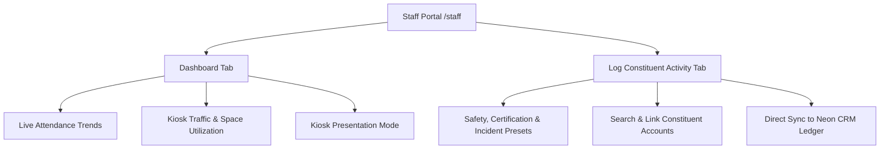
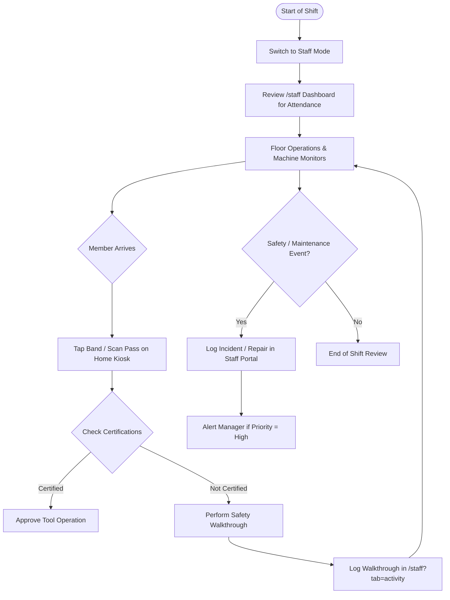

# Staff Onboarding & Operations Guide
**Social Medium Makerspace Web Application**
*Version 4.4.1 — Operational Reference Manual*

---

## Welcome to the Team!

Welcome to Social Medium! As a staff member or shop lead, you are the heart of our friendly neighborhood makerspace. You help our community members forge friendships, explore their creativity safely, learn new maker tools, and make something amazing.

The **Social Medium Web Application** (`https://app.socialmedium.space`) is your daily command center for front-desk check-ins, member tool safety verification, constituent activity logging, and community engagement.

---

## Table of Contents
1. [Quick-Start Checklist (First 10 Minutes)](#1-quick-start-checklist-first-10-minutes)
2. [Staff Access & Roles (How to Sign In)](#2-staff-access--roles-how-to-sign-in)
3. [Front-Desk & Entrance Check-Ins](#3-front-desk--entrance-check-ins)
4. [Staff Operations Portal (`/staff`)](#4-staff-operations-portal-staff)
   - [A. Operational Dashboard](#a-operational-dashboard)
   - [B. Logging Constituent Activities & Safety](#b-logging-constituent-activities--safety)
5. [Facilitating Member Features](#5-facilitating-member-features)
   - [Buddy Bubbles & In-Person Meetup Check-Ins](#buddy-bubbles--in-person-meetup-check-ins)
   - [Buddy Bucks & Digital Mascots](#buddy-bucks--digital-mascots)
   - [Giving Tuesday & Impact Campaigns](#giving-tuesday--impact-campaigns)
6. [Daily Staff Workflow (Routine Diagram)](#6-daily-staff-workflow-routine-diagram)
7. [Troubleshooting & FAQs](#7-troubleshooting--faqs)
8. [Important Contacts & Escalations](#8-important-contacts--escalations)

---

## 1. Quick-Start Checklist (First 10 Minutes)

- [ ] **Open the App**: Navigate to `https://app.socialmedium.space` on your mobile phone or the front-desk tablet.
- [ ] **Sign In**: Tap the profile icon or use your staff credentials / Buddy Band.
- [ ] **Enable Staff Mode**: Check the top navigation bar. If you see `User Mode`, click it and select **`Staff Mode`** (requires staff permissions in Neon CRM or App Developer role).
- [ ] **Verify Access to `/staff`**: Click **More** in the bottom navigation and select **Staff Portal** (or navigate to `/staff`).
- [ ] **Test a Sample Log**: Review the **Log Activity** tab to see how safety walkthroughs, certifications, and incident notes are recorded.

---

## 2. Staff Access & Roles (How to Sign In)

The application connects directly to our **Neon CRM** database and local offline cache.

### Role Switching
At the top-right of your navigation bar, you will see a badge indicating your current operational mode:
- **`👤 User`**: Standard member view.
- **`🛡️ Staff`**: Enables staff tools, activity logging, and analytics dashboards.
- **`</> Developer`**: Simulation and testing playground (for developer accounts).

```
┌────────────────────────────────────────────────────────┐
│ 👥 Social Medium   v4.4.1   [ 🛡️ Staff ▾ ]   [ 1414... ● ] │
└────────────────────────────────────────────────────────┘
```

> **Tip**: If your account doesn't automatically switch to Staff Mode, tap the mode pill at the top, select **Staff**, and enter your credentials. If you are locked out, contact Ilana or Ben to ensure your Neon account has staff permissions.

---

## 3. Front-Desk & Entrance Check-Ins

Every maker who enters Social Medium checks in at the front portal. Check-in records attendance, verifies active membership, and checks tool safety certifications.

### How to Check In a Member
1. **Physical Buddy Band Tap (NFC)**:
   - Ask the member to hold their Buddy Band against the front-desk reader or the back of your NFC-enabled staff phone.
   - The app reads the band's hardware serial number (UID) and instantly displays their member profile card.
2. **QR Code Scan**:
   - If the member's phone doesn't have NFC, ask them to open **Profile > My Buddy Pass**.
   - Scan their QR code with the kiosk camera.
3. **Manual Name / Card Search**:
   - If a member forgot their band, tap the search bar on the Home screen and type their first or last name, email, or 10-digit card number.

### What to Verify on the Member Card
- **Membership Tier & Status**: Look for a green **Active** badge (e.g., *Community Pro Maker*, *Day Pass*).
- **Safety Certifications**: Icons under their nametag show which shop zones they are certified to operate:
  - 🟢 *Laser Cutter (CO2 80W)*
  - 🟢 *3D Printing (FDM / Bambu Lab)*
  - 🟢 *Woodshop Safety & Table Saw*
  - 🟢 *Electronics & Soldering Bench*
  - 🟢 *Vinyl Cutter & Heat Press*
- **Safety Warning**: If a member attempts to use a tool they are *not* certified for, schedule a quick walkthrough before they operate the machine.

---

## 4. Staff Operations Portal (`/staff`)

Access this portal via the bottom navigation under **More > Staff Portal** or directly at `/staff`.



---

### A. Operational Dashboard (`/staff?tab=dashboard`)

The dashboard gives staff real-time visibility into space activity:
- **Live Attendance**: Number of makers currently checked in.
- **Hourly Traffic Trends**: Peak hours to help adjust volunteer and shop monitor coverage.
- **Constituent Activity Ledger**: Recent safety walkthroughs, tool certifications, and guest visits.
- **Kiosk Fullscreen Mode**: Click the **Fullscreen** button in the top toolbar to display attendance charts on an overhead front-desk monitor.

---

### B. Logging Constituent Activities & Safety (`/staff?tab=activity`)

Staff must log member interactions, machine certifications, and incidents directly into the Neon CRM constituent ledger.

#### Step-by-Step Logging Procedure:

1. **Select a Common Preset**:
   Click one of the 1-click preset pills to auto-populate the form:
   - 🛠️ **Equipment Safety Walkthrough**: After conducting a tool safety check.
   - 👋 **Member Orientation & Intake**: For new members completing onboarding.
   - ⚠️ **Incident / Safety Report**: For machine malfunctions, rule violations, or injuries.
   - 🔧 **Tool Maintenance / Servicing**: When replacing laser mirrors, 3D printer nozzles, or saw blades.
   - 🚪 **Workshop Check-In**: For special classes or hosted group visits.
   - 📝 **General Staff Note**: For general constituent observations.

2. **Form Details**:
   - **Subject**: A clear, concise title (e.g., *"Laser Cutter 80W Certification - Alex Smith"*).
   - **Type**: Select from Neon CRM activity categories (*Safety Walkthrough, Certification, Facility Maintenance, Member Note*).
   - **Status**: Defaults to **Completed** (or choose *In Progress* / *Scheduled*).
   - **Priority**: Mark as *High* if follow-up by management (Ilana/Ben) is required.
   - **Date & Time**: Auto-fills to the current local timestamp.

3. **Assign Staff & Link Members**:
   - **Assigned Staff**: Auto-selects your name. You can select multiple staff members if you co-led the orientation.
   - **Associated Members**: Type the member's name or email in the search field, click **Search**, and select the member(s) to attach them to the permanent ledger entry.

4. **Internal Notes**:
   Write objective, clear notes (e.g., *"Alex demonstrated proper exhaust ventilation setup, focal height calibration with acrylic spacer, and safe fire extinguisher location awareness."*).

5. **Submit**:
   Click **Log Activity to Neon CRM**. A green confirmation banner with the Neon Activity ID will appear upon successful sync.

---

## 5. Facilitating Member Features

Members will often ask staff questions about the app's community features. Here is what you need to know:

### Buddy Bubbles & In-Person Meetup Check-Ins
- **What is a Buddy Bubble?**
  A private, proximity-based connection system. Members add friends in person by tapping phones or scanning their **Buddy Pass QR**. There is **no public directory**, protecting member privacy.
- **Custom Bubbles**:
  Members create themed groups like *"D&D Club"*, *"Denim Jacket Squad"*, or *"Robotics Guild"*.
- **Hosting a Bubble Check-In (New in v4.4)**:
  - If a member is the Admin of a custom bubble, they can tap **Bubble Check-In** to open an in-person attendance kiosk.
  - Fellow members tap their Buddy Band or scan the on-screen QR code.
  - **Reward**: Both the member and the bubble treasury earn **+5 Buddy Bucks** (limit 1 check-in per member per bubble per day).
  - **Full Party Bonus**: If 100% of the bubble's members check in on the same day, everyone and the bubble wallet earn an extra **+5 Buddy Bucks** (+10 BB total!).

### Buddy Bucks & Digital Mascots
- **What are Buddy Bucks (BB)?**
  In-app currency earned by donating to campaigns, leveling up XP, attending events, and checking in to bubbles.
- **Buddy Builder Store (`/store`)**:
  Makers spend Buddy Bucks on coloring-book clothing items, robot accessories, capes, and wizard hats to dress their 2D mascot.

### Giving Tuesday & Impact Campaigns (`/impact`)
- Staff can open `/impact` to show the live thermometer for community fundraising.
- Every \$1 donated awards 1 Buddy Buck to the donor's digital wallet!

---

## 6. Daily Staff Workflow (Routine Diagram)



---

## 7. Troubleshooting & FAQs

### Q1: The member's Buddy Band is not reading when tapped against my phone.
- **Solution**:
  1. Ensure Web NFC is supported and turned on in device settings (Android Chrome supports Web NFC natively; for iOS or non-NFC tablets, use QR codes).
  2. Hold the band flat against the upper back of the phone (near the camera lens).
  3. If their band is damaged or unreadable, have the member open **Profile > My Buddy Pass** and scan their QR code with the camera.

### Q2: A member says they are certified for the laser cutter, but their card doesn't show it.
- **Solution**: Check the Neon CRM constituent record. If they recently completed a safety checkout with an instructor, log a new **Equipment Safety Walkthrough** activity under `/staff?tab=activity` and notify management so their profile tags update.

### Q3: Can I manually check in members for their Bubble Check-In if their phone is dead?
- **Solution**: No. Version 4.4.1 strictly requires physical in-person verification (NFC band tap or QR scan) to prevent buddy gaming. Members must have their physical band or phone with them.

### Q4: The app shows "Offline Mode". Will my logged activity be lost?
- **Solution**: No! The app features offline-first local caching. Activities and check-ins are cached in `localStorage` and automatically sync to Neon CRM once network connectivity is restored.

---

## 8. Important Contacts & Escalations

| Name | Role | Phone | Email | When to Contact |
| :--- | :--- | :--- | :--- | :--- |
| **Ilana Jaffe-Lewis** | Manager | (747) 322-0689 | `ilana@socialmedium.space` | HR, member disputes, escalated safety incidents |
| **Starline 'Star' Hodge** | Assistant Manager | (818) 646-6803 | `star@socialmedium.space` | Daily shop operations, programming, teen club |
| **Ben Braunstein** | Board President / Tech | (818) 648-1314 | `ben@socialmedium.space` | App errors, CRM data issues, legal/facility emergency |
| **General Staff Desk** | Front Desk | (818) 646-6844 | `staff@socialmedium.space` | General questions, shift coverage |

*Social Medium Nonprofit — 7521 Fallbrook Ave, West Hills, CA 91307*
